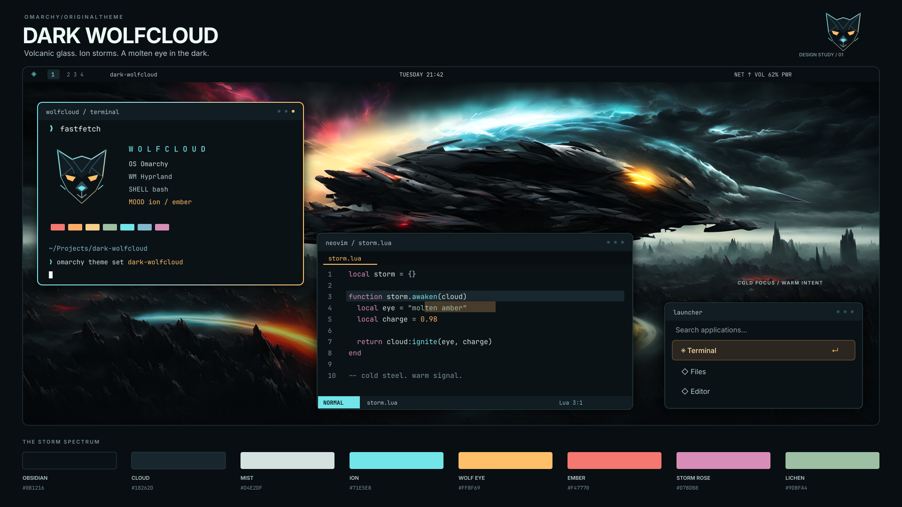

# Dark Wolfcloud

**Volcanic glass. Ion storms. A molten eye in the dark.**

An original Omarchy theme built around `dark-wolfcloud.png`. Deep blue-black
surfaces carry glacial cyan focus, amber selection, ember diagnostics, and
storm-pink syntax. The wallpaper stays intact; color is concentrated where
it helps you find your place.



## Install

From this directory, run:

```sh
./install.sh
```

This registers a symlink at `~/.config/omarchy/themes/dark-wolfcloud` and applies
it with `omarchy theme set dark-wolfcloud`. Keep this directory in place.
The installer refuses to replace a different existing theme.

To use the previous theme again:

```sh
omarchy theme set scanner-darkly
```

## The palette

| Role | Color | Purpose |
| --- | --- | --- |
| Void | `#05090c` | Deepest layer and scrims |
| Obsidian | `#0b1216` | Terminal and editor canvas |
| Cloud | `#18262d` | Raised surfaces |
| Mist | `#d4e2df` | Main text |
| Ion | `#71e5e8` | Focus, functions, active workspaces |
| Wolf eye | `#ffbf69` | Selected controls and menus |
| Ember | `#f47770` | Errors and heat |
| Storm rose | `#d78db8` | Keywords and secondary accents |
| Lichen | `#9dbfa4` | Strings and successful operations |

A cyan → mist → amber gradient connects active window borders to the
wallpaper's two light sources. Inactive borders return to dark steel.
Selections use warm bronze with pale text, so they remain recognizable
beside cyan focus. Shell cards use subdued steel borders to keep the
bright gradient concentrated on the main interaction.

## Wallpaper collection

Three ultrawide scenes are included in the native background selector:

1. **Dark Wolfcloud** — the original floating obsidian wolf and dual energy arc
   (3440 × 1440).
2. **Ion Hunt** — a storm wolf crossing volcanic spires above a cyan river
   (1938 × 811).
3. **Emberwake** — an obsidian colossus rising from a caldera, with an amber
   fissure cutting through the foreground (1938 × 811).

The two companions were created with the built-in image generation tool,
using the original only as a visual reference. Native generated pixels are
preserved; Omarchy fits them to the monitor. Full prompts and source paths
are recorded in [assets/wallpaper-prompts.json](assets/wallpaper-prompts.json).

Cycle through them with:

```sh
omarchy theme bg next
```

## Wallpaper transitions

Dark Wolfcloud uses a **280 ms crossfade with a subtle horizontal drift**.
The drift alternates direction and settles onto the untouched wallpaper.
The normal wallpaper selector and `omarchy theme bg next` both use it.

`./install.sh` installs this through Omarchy's supported background-plugin
clone, named `<username>.background`. Motion applies only while Dark Wolfcloud
is selected; other themes retain the native reveal. Omarchy's global animation
setting is respected. The installer backs up `shell.json` first and refuses to
replace a background clone it does not own. To install just the motion:

```sh
python tools/install-wallpaper-motion.py
```

To return to the built-in background renderer:

```sh
omarchy plugin enable omarchy.background
```

## Coverage

- Omarchy shell: bar, launcher, menus, controls, flyouts, notifications,
  authentication prompts, and standard lock input.
- Alacritty, Kitty, Foot, Ghostty, tmux, Helix, VS Code, Neovim, and agent
  tools receive the shared palette through Omarchy's native templates.
- A dedicated btop theme maps activity from cold cyan to amber and ember.
- Chromium uses storm steel; GTK uses dark mode and installed
  `Yaru-prussiangreen` icons.
- Original vector wolf crest plus transparent `unlock.png` and picker art.

Designed against the installed Omarchy **4.5** schema. `colors.toml` is the
source of truth; `shell.*.toml` files replace individual shell sections while
allowing Omarchy to generate the rest. No system templates, keybindings,
packaged plugin code, or window layouts are changed. Custom shell plugins can choose
their own lock artwork and may not use the standard lock tokens.

The Neovim file extends Omarchy's aether integration with cyan functions,
warm search, and a bronze visual selection. Omarchy regenerates Lua files
from its own templates when installing a theme from a remote git clone;
the base palette and gradients still apply in that mode.

`preview.png` is a rendered design study, not a desktop capture. Regenerate
it with `python tools/build-preview.py` (requires `rsvg-convert`).
`assets/wolfcrest.svg` is editable vector source; the supplied background is
a copy of the user's wallpaper. No ownership or redistribution rights are
asserted over that image.
